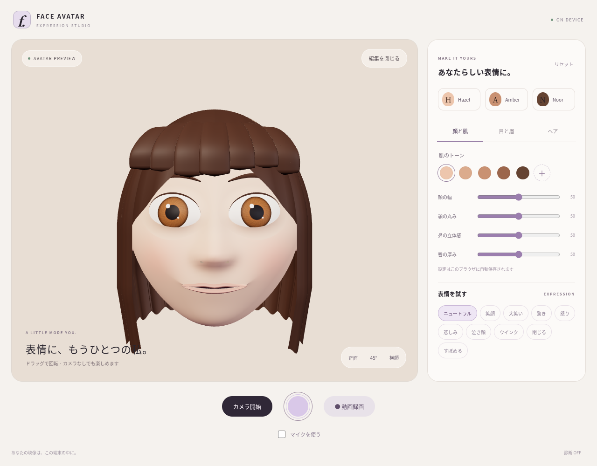

# Face Avatar — Expression Studio

React + TypeScript + Vite + Three.js + MediaPipeで動く、端末内処理の3Dアバターカメラです。カメラ映像を背景として描画し、顔の位置・向き・表情にオリジナルのアバターを重ねます。Cloudflare Pagesに静的ファイルとして配置できます。認証、アプリ用サーバー、有料AI APIは不要です。



## セットアップ

Node.js 20.19+ または22.12+を推奨します。

```sh
npm ci
npm run dev
```

開発サーバーはHTTPSの `https://localhost:5173`。スマートフォンからは同じネットワーク上の開発マシンのIPを使用します。開発用の自己署名証明書は端末によって信頼設定が必要です。実機確認には正規HTTPSのCloudflare PagesプレビューURLを推奨します。

```sh
npm run build
npm run preview
```

出力は `dist/`。既存のReact / TypeScript / Three.js / MediaPipe構成を維持しています。

## プレビューと編集

起動するとカメラ許可なしでアバターを表示します。

- ドラッグで回転。「正面」「45°」「横顔」で造形を確認。
- Hazel / Amber / Noorプリセット、5段階の肌色と自由な色選択。
- 顔の幅、顎、目の大きさ・丸み、瞳色、眉のアーチ、鼻の立体感、唇の厚みを調整。
- ボブ／ショート／ロングの長さバリエーションと髪色。
- ニュートラル、笑顔、大笑い、驚き、怒り、悲しみ、泣き顔、ウインク、閉眼、すぼめる表情を試せます。泣き顔は表情のみで、涙のエフェクトはありません。
- 設定は `localStorage` の `face-avatar-studio:v1` に保存。不正な値は検証・補正し、保存できない環境では画面に通知します。

形状の変更時はメッシュを生成し直します。旧メッシュ・マテリアルは解放します。ユーザーが追加GLBを用意する必要はありません。

## カメラと顔追従

「カメラ開始」で前面カメラを起動します。マイクは初期状態でOFFです。カメラ開始前に「マイクを使う」を選ぶと音声付き録画を試みます。マイクを取得できない場合は映像のみへフォールバックします。録画中以外は前面・背面の切替が可能です。前面だけを鏡表示にします。

MediaPipeの回転行列と、額・顎・左右頬のランドマークから位置とサイズを求めます。カメラ映像と同じ `contain` 表示領域を使って画面座標を合わせます。「顔を覆う範囲」で余白を調整できます。「表情を補正」は1.5秒間の無表情を基準にします。

映像・推論結果をアップロードしません。ただし初回のトラッキング開始時には、MediaPipe WASMをjsDelivr、モデルをGoogle Storageからダウンロードします。**初回から完全オフラインで動く構成ではありません。** 配信元のURLは `src/hooks/useFaceLandmarker.ts` にあります。必要ならバージョンを揃えたWASMとモデルを `public/` に配置してURLを変更してください。

### 合成の範囲と限界

- 元映像はアバターの描画範囲外で維持されます。背景・衣服・身体の置換処理はありません。
- 実装は顔メッシュによる不透明な遮蔽です。**元の髪のセグメンテーション、背景復元、実写の首との完全な境界融合は未実装**です。元の髪型や横顔によって縁に実写が残ります。
- 顔を見失うと古い位置のアバターを隠し、元映像が表示されます。録画にも反映されるため、匿名化用途の保証はありません。
- 追従OFFではアバターを固定位置でプレビューします。実写の顔の上に配置し続けるモードではありません。
- 極端な横顔、手による遮蔽、急な動き、逆光は実機で追加調整が必要です。

## 写真・動画・保存

- 中央のシャッター：合成済みキャンバスのPNG写真を生成。カメラなしでも撮影できます。
- 「動画録画」：合成済みキャンバスを30fps指定で録画。停止後に動画プレビューとダウンロードを表示。
- MediaRecorderが対応するMIMEを検出し、明示的なH.264 MP4を優先。対応しない場合はWebM、最後にブラウザ標準のMP4を選択。
- File共有に対応する環境では「共有」を表示。iPhoneでは共有シートの画像／ビデオ保存を利用できます。
- 非対応ブラウザには写真利用を案内。録画終了・失敗時に録画用トラックを解放します。カメラの音声トラックは複製して使用し、録画終了で元のマイクを停止しません。
- 録画中のモデル編集・カメラ切替を無効化。カメラ停止・WebGLコンテキスト喪失時は録画を停止します。

iOS SafariのMediaRecorder / canvas.captureStream / ファイル共有の対応状況はOS・端末によって異なります。**本変更ではiPhone実機での録画・音声・共有を未検証**です。MP4が生成されることや写真アプリに直接保存できることを全端末で保証しません。

## 3D造形と保守

すべて本リポジトリで生成するオリジナルのメッシュ・色・シェーダーです。Appleのモデル、画像、テクスチャ、UI素材は含みません。

| ファイル | 役割 |
| --- | --- |
| `src/three/sculptGeometry.ts` | 頬・鼻筋・鼻先・小鼻・顎・口元を連続曲面で構成。開口部、唇、モーフ位置・法線、頂点色、継ぎ目の法線補正 |
| `src/three/createEyes.ts` | 曲面の白目、放射状の虹彩・瞳孔・キャッチライト、視線、上下まぶた。開口面とまぶたの共有境界 |
| `src/three/createHair.ts` | 連続した頭頂、重なった側面の毛束、厚みのある前髪 |
| `src/three/createAvatar.ts` | リグ構成、歯列・舌・耳、GPUモーフ、リソース解放 |
| `src/three/avatarMaterials.ts` | マット寄りの肌、髪・唇の材質 |
| `src/three/applyExpression.ts` | MediaPipeから顎・左右笑顔・口すぼめ・口角下げ・頬膨らみ、眉・瞼・視線へのマッピング |
| `src/three/fitFaceToVideo.ts` | 実写と同じ表示矩形による位置・サイズ合わせ |
| `src/avatar/` | 編集値の検証、プリセット、表情プレビュー |

肌の柔らかさは頂点色の血色、広い拡散光、粗さで表現しています。物理的なSSSや高負荷のポストプロセスは使用しません。細かな表情チャンネルすべての独立モーフ、歯の個別モデル、涙、毛髪シミュレーションはありません。

## パフォーマンスと端末対応

- 基本アバターは約5万三角形、最大46ドローコール。数値は `docs/qa/results.json` を参照。
- タッチ端末の描画を30fps目標に制限、その他は60fps目標。推論は最大24Hz、検出に時間がかかる場合は最大12Hz相当まで間隔を延ばします。
- 描画と推論の実行間隔を分けていますが、**推論はメインスレッド上の同期処理**です。Worker化は未実装です。
- DPRはタッチ端末1.5、その他2を上限とし、低fpsが続く場合は1まで段階的に削減。
- 背景タブでは描画・推論を休止。カメラ停止・コンポーネント破棄でストリームを解放。
- WebGL喪失／復旧、safe-area、`dvh`、横幅390pxの操作を考慮。ボタンは `touch-action: manipulation`、3Dドラッグ領域は `touch-action: none`。ページのピンチ拡大は維持します。
- 「診断」で描画fps・三角形数・ドローコール・DPRと推論fpsを表示。

30/60fpsは設計目標であり、実機測定値ではありません。iPhoneのGPU・発熱・バッテリーは未測定です。

## 検証

```sh
npm run build
npx playwright install chromium
npm run test:browser
# システムChromiumの場合
CHROMIUM_PATH=/usr/bin/chromium npm run test:browser
```

Playwrightは開発用依存だけです。検証スクリプトはHTTPS開発サーバーを5174ポートで起動し、スクリーンショットと `docs/qa/results.json` を生成します。カメラは合成入力を使います。実際の顔の検出精度は検証しません。

MediaPipe本体とCDNのWASMは **0.10.35** に揃えて固定しています。実モデルのGPU／CPU初期化と空画像での推論は、別のスモークテストで確認できます（カメラや人物画像は使いません）。

```sh
curl -fL https://storage.googleapis.com/mediapipe-models/face_landmarker/face_landmarker/float16/latest/face_landmarker.task -o /tmp/face_landmarker.task
MODEL_PATH=/tmp/face_landmarker.task npm run test:tracking
# システムChromiumなら CHROMIUM_PATH=/usr/bin/chromium も指定
```

WASMはインストール済みパッケージから、モデルは指定したローカルファイルから検証ブラウザへ配信します。結果は `docs/qa/tracking-smoke.json`。ライブCDN配信や実際の人物の顔追従を確認するテストではありません。

視覚比較・手動評価・残課題は [品質監査](docs/QUALITY.md) を参照してください。

## Cloudflare Pages

GitHub連携でPagesプロジェクトを作成し、以下を設定します。

| 設定 | 値 |
| --- | --- |
| Framework preset | Vite |
| Build command | `npm run build` |
| Build output directory | `dist` |
| Root directory | リポジトリルート |
| Node.js | 22 |

既存の安定ブランチは `claude/face-replacement-video-app-pNRQB`。変更は別ブランチ `codex/premium-avatar-studio` でレビューしてください。PRのプレビューデプロイで実機確認してから統合する運用を推奨します。本作業から本番環境へのデプロイは行っていません。
