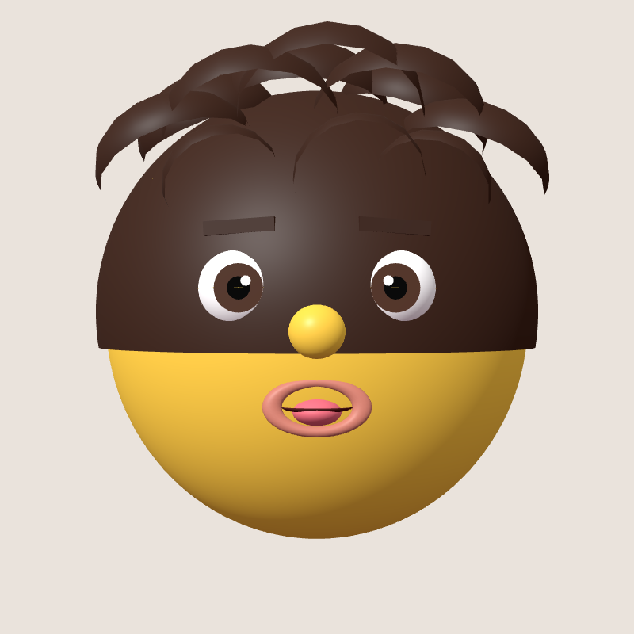
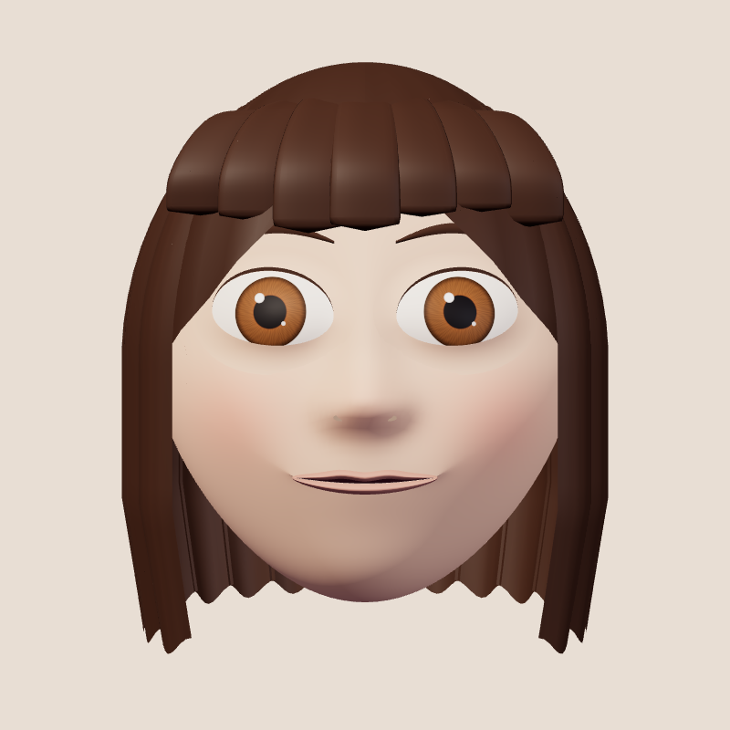
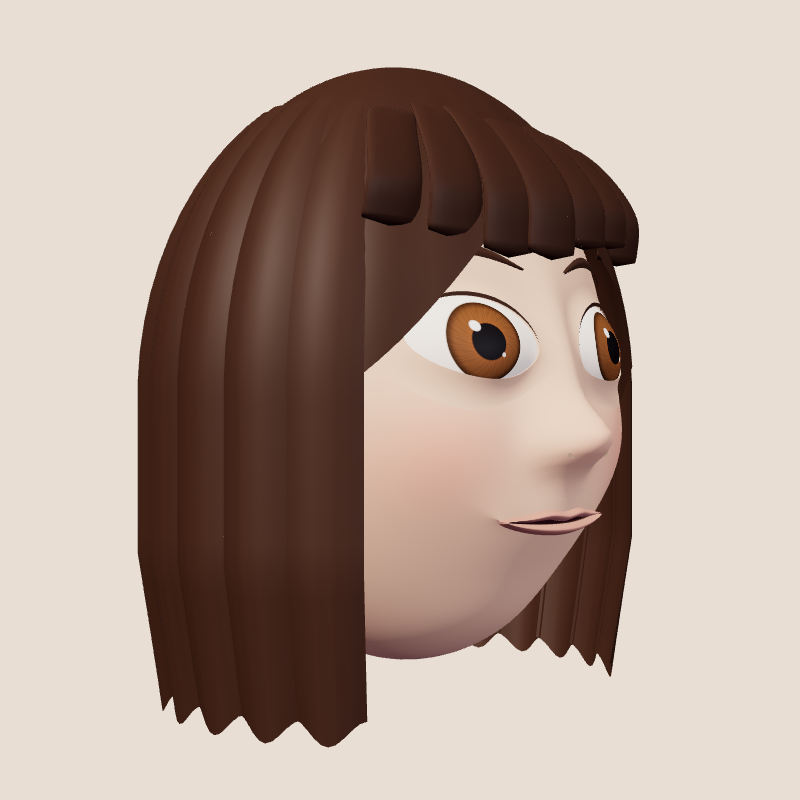
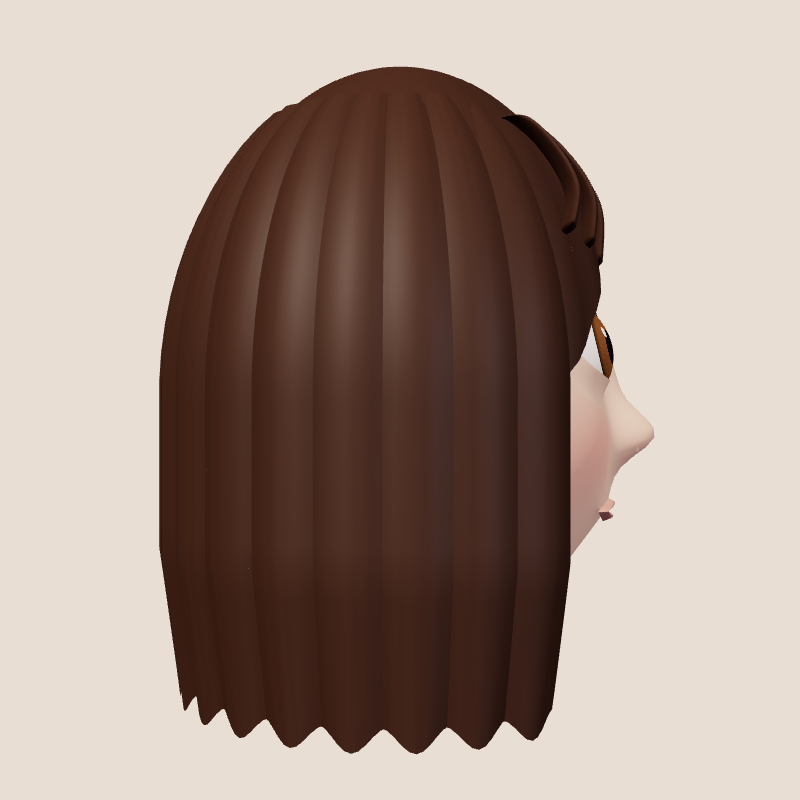
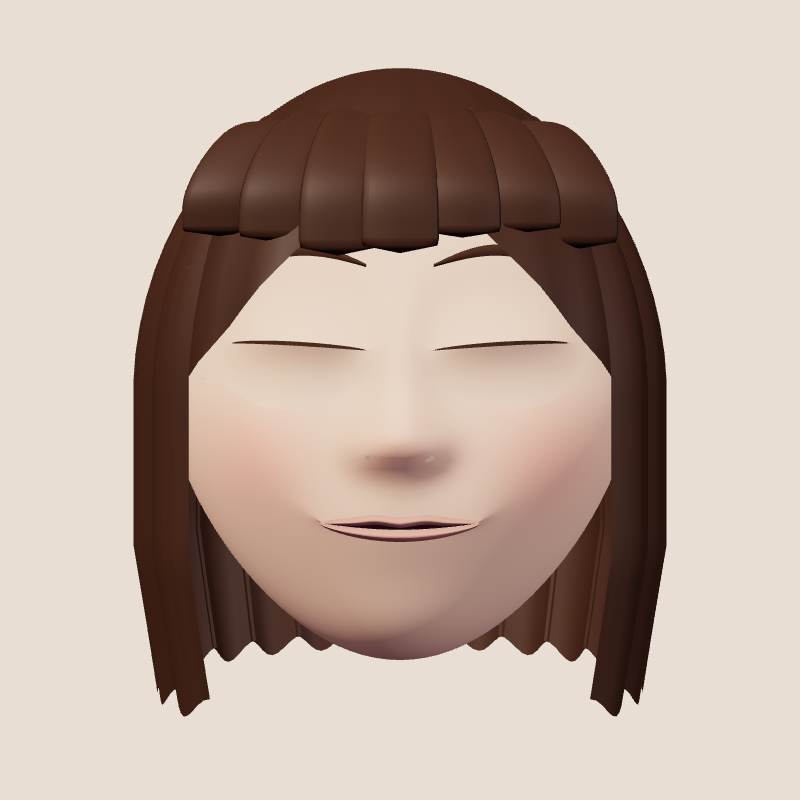
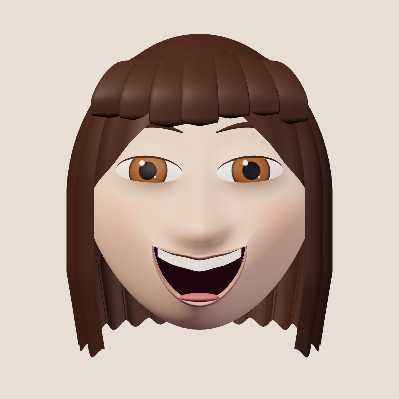
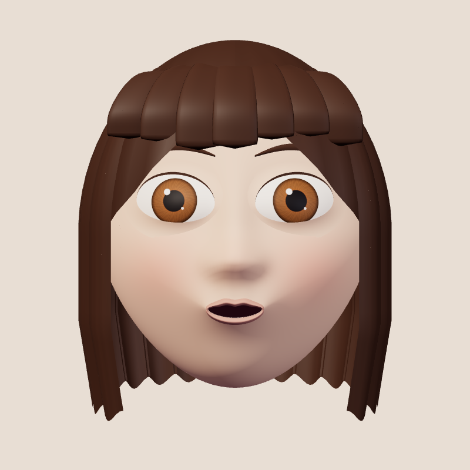
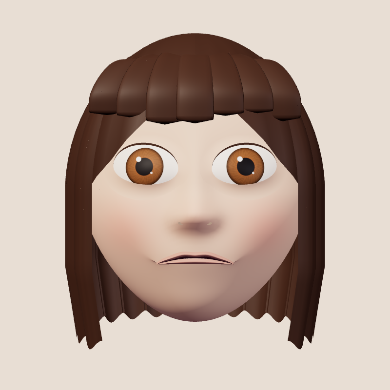

# Premium avatar upgrade — quality audit

## Scope and implementation choice

Base: `59f698e`, branch `claude/face-replacement-video-app-pNRQB`.
Work branch: `codex/premium-avatar-studio`.

The existing React / TypeScript / Vite / Three.js / MediaPipe application was retained. The procedural avatar generator and rig were improved; camera, recorder, calibration and debug flows remain part of the same application.

Blender and Chromium were available. No Blender asset or GLB was created or claimed. Custom BufferGeometry was selected because it allows deterministic face editing, consistent morph topology and no model download. A professionally sculpted GLB could offer greater artistic control, but it would also require authored morph targets, a parameter editing strategy, and additional asset review. An external paid generation API was not used.

## Visual comparison

| Previous model | New original model |
| --- | --- |
|  |  |

The comparison uses the same camera framing, with different studio lighting/material settings appropriate to each implementation. It is a visual comparison, not a controlled shader benchmark.

| 45 degrees | Profile | Full blink |
| --- | --- | --- |
|  |  |  |

| Laugh | Pucker | Sad |
| --- | --- | --- |
|  |  |  |

Visual iterations removed a visible radial normal seam across the cheek, reduced the protruding eyelid ring, shortened the chin, increased iris size, rounded the fringe cross sections, and attached the teeth strip to the upper mouth contour. These were actual rendered issues, not hypothetical improvements.

## Difference from the supplied quality references

The reference images were used to identify desired softness, large readable eyes, brunette fringe, restrained highlights and expressive mouth shapes. No reference pixels, textures, models or UI assets were incorporated.

The new model has a continuous cheek/nose/chin surface, iris fibers and pupils, an integrated eye aperture, a real mouth opening, and connected facial deformation. However, it does **not** match the polish of an artist-authored commercial character. Hair still reads as broad sculpted locks, the eyelid crease and philtrum are simplified, ears are lightly detailed and usually concealed, and skin uses diffuse tint rather than subsurface scattering. Profile and expression images should be reviewed as an original procedural character, with further artistic refinement remaining.

## Verification evidence

`qa/results.json` is generated by `npm run test:browser` and records the exact completed checks, browser version and draw statistics. `qa/studio-mobile.png` is a Chromium touch/390px viewport screenshot; it is not an iPhone Safari screenshot.

The 11 passing browser checks cover camera-free startup, localStorage edits, PNG capture, canvas recording/playback and track release, recovery from encoder errors and late callbacks, WebGL loss/restore, mocked permission denial, synthetic camera track cleanup, mobile overflow, finite geometry at extreme settings, time-based smoothing, centered fitting, and eight rendered pose/expression cases.

Closing eyes hides the ocular surface and joins both lid boundaries. This is checked both programmatically and by the blink screenshot. A closed eye is not a shrinking sphere that can pierce a separate lid.

The final audit also found a pre-existing mismatch between the installed MediaPipe JavaScript (0.10.35) and the WASM URL (0.10.21). Both are now pinned to 0.10.35. The separate `qa/tracking-smoke.json` records successful GPU and CPU initialization and inference on a blank synthetic image using the real model. Assets were served from local files at the production URLs during this test; live CDN delivery and human face tracking remain unverified.

`npm run build` succeeds. Vite reports a non-failing large-chunk warning for the Three.js/application bundle (~644 kB, ~180 kB gzip). MediaPipe is loaded only when camera tracking starts, as a separate ~136 kB chunk. The MediaPipe npm distribution also lacks a referenced development source map; Vite logs this during the smoke test, without preventing model initialization.

## Remaining device and production checks

- Actual iPhone Safari: 30fps stability, supported 60fps devices, heat, battery, context recovery under memory pressure, repeated background/foreground transitions.
- Actual human MediaPipe inference: moving heads, roll/pitch/yaw, independent gaze, varied lighting, neutral calibration, extreme expressions, multiple skin tones, rear camera mirroring.
- Safari audio capture, MP4 codec behavior, long recordings, share sheet / Photos saving, low-memory failures.
- Original hair removal, segmentation, hidden-background reconstruction and natural live neck boundaries are **not implemented**. Increasing coverage is a heuristic and can cover more background or neck.
- Brow/eye/nose/lip editing is parametric; bun and center-part hair variants, physically modeled SSS, tears and individual teeth are not implemented.
- Tracking loss exposes the original video; this is not an anonymization product.
- Static build compatibility is checked locally. No Cloudflare production deployment was performed.
